# ha-backup-card

[](https://www.home-assistant.io/integrations/marketplace/)
[](https://github.com/juju35/ha-backup-card/actions/workflows/hacs.yml)
[](https://github.com/juju35/ha-backup-card/actions/workflows/validate.yml)
[](https://github.com/juju35/ha-backup-card/actions/workflows/lint.yml)
[](https://github.com/juju35/ha-backup-card/releases/latest)
[](https://github.com/juju35/ha-backup-card/blob/main/LICENSE)
[](https://buymeacoffee.com/julienstep9)

<p align="center"></p>

<p align="center">
  &nbsp;&nbsp;
  &nbsp;&nbsp;
  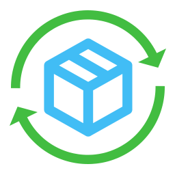&nbsp;&nbsp;
  &nbsp;&nbsp;
  &nbsp;&nbsp;
  &nbsp;&nbsp;
  &nbsp;&nbsp;
  &nbsp;&nbsp;
  
</p>

Lovelace cards for Home Assistant for your **backups**: the **age of the last good backup** of each source against its limit, a **status** (up to date, late, failed, running), its **size**, the **next scheduled** one and a button that **backs up now**, from [Home Assistant's own backups](https://www.home-assistant.io/integrations/backup/), the [Google Drive Backup](https://github.com/sabeechen/hassio-google-drive-backup), [Samba Backup](https://github.com/thomasmauerer/hassio-addons/tree/master/samba-backup) and [OneDrive Backup](https://github.com/lavinir/hassio-onedrive-backup) add-ons, [Proxmox VE](https://www.home-assistant.io/integrations/proxmoxve/), [Auto Backup](https://github.com/jcwillox/hass-auto-backup), [Duplicati](https://github.com/txxa/hass-duplicati), [Duplicati Monitor](https://github.com/andlo/ha-duplicati-monitor), [Backrest](https://github.com/vakhariaheet/backrest-hacs) and Veeam, or any other "last backup" sensor.

The sources are **discovered automatically** from the Home Assistant entity and device registries: an empty configuration already shows your backups, whatever your Home Assistant language or entity ids. Any "last backup" sensor can also be set in the configuration, with its own limit.

[](https://my.home-assistant.io/redirect/marketplace_repository/?owner=juju35&repository=ha-backup-card&category=plugin)

| Backup Card | Backup Mini Card |
|---|---|
| 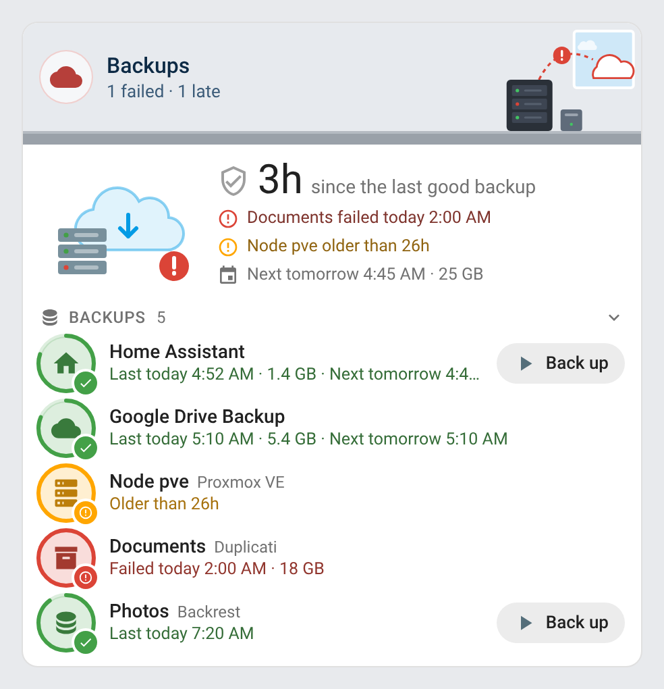 | 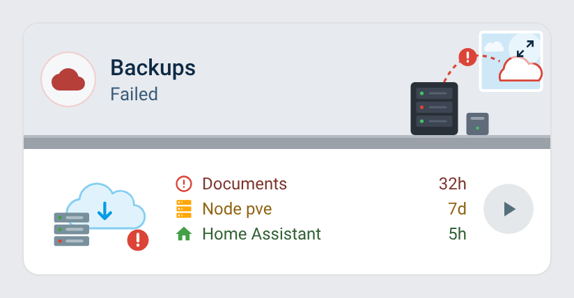<br>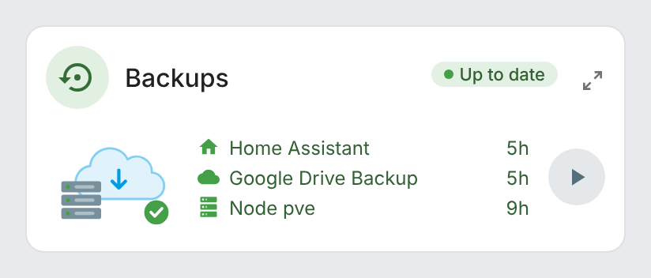 |

## Features

- Two cards: a full **Backup Card** (`custom:backup-card`) and a compact **Backup Mini Card** (`custom:backup-mini-card`)
- One row per source: a **ring** that empties as the last good backup gets older (full just after a backup, empty at the limit), the source's icon and a status badge
- **Status** of each source: **Up to date**, **Late** (older than `max_age`, 26 hours by default, or a scheduled backup missed by an hour), **Failed** (an attempt or a failure after the last good backup, an error status, a failed sensor), **Running**
- When the last backup was made, its **size** and the **next scheduled** one; its age as a ring round its icon, against its limit
- **Summary** above the list, as on the other cards: an illustration with the worst status, the time since the newest good backup, the failed and late sources, the next backup and the total size
- **Back up now** button, each integration its own way (see [Backing up now](#backing-up-now)); while a backup runs, the arrow goes into the cloud and an arc turns round its source (see [Animations](#animations))
- **Illustrated header** (90 px, full and mini card): the home server and its backup disk on a concrete floor, linked to a cloud seen through the window, in the worst status: a green check when up to date, packets going up the link while a backup runs, an amber link when late, a red link and a red server light when one failed; night version with a dark Home Assistant theme, `illustration: false` for the classic header with its status chip
- Header icon in a round badge, in the colour of the worst status (green, blue while running, amber, red, grey); the subtitle counts the failed, late and running ones
- Collapsible list, folded back to its default by a click elsewhere on the page
- Click a source to open its Home Assistant history (more-info dialog)
- Detail button on the mini card (top right): it switches the mini card to the full card's content and back; a click anywhere outside the card brings the compact view back
- Visual editor in the dashboard UI for both cards (no YAML needed)
- Light and dark mode, English, French, German, Spanish, Serbian (Cyrillic and Latin), Italian, Dutch, European Portuguese, Polish, Romanian, Danish, Swedish, Bulgarian, Russian, Ukrainian, Hungarian, Slovak, Czech, Slovenian, Latvian and Greek
- Single file, no external dependency

## Supported integrations

| Integration | What the cards use |
|---|---|
|  [Backup](https://www.home-assistant.io/integrations/backup/) (core) | Last successful and last attempted automatic backups, next scheduled one, size, backup manager state; backs up with `backup.create_automatic` |
|  [Google Drive Backup](https://github.com/sabeechen/hassio-google-drive-backup) (add-on) | `sensor.backup_state`: its state (`error` is a failure), `last_backup`, `next_backup`, `size_in_google_drive` |
|  [Samba Backup](https://github.com/thomasmauerer/hassio-addons/tree/master/samba-backup) (add-on) | `sensor.samba_backup`: its state (`RUNNING`, `FAILED`) and `last_backup`; backs up through the add-on's input when `addon` is set |
|  [OneDrive Backup](https://github.com/lavinir/hassio-onedrive-backup) (add-on) | `sensor.onedrivebackup`: its state (`Syncing` runs, `Stale` is late) and its last OneDrive (or local) backup date |
|  [Proxmox VE](https://www.home-assistant.io/integrations/proxmoxve/) (core, or the custom integration) | The backups of each node: last backup, backup status (a failure) and, with the custom integration, backup running and its *Back up all* button. Only entities about backups are read: the node's status, health and power buttons and the guests are left out (the backup entities of the custom integration are disabled by default: enable them) |
|  [Auto Backup](https://github.com/jcwillox/hass-auto-backup) (custom, `auto_backup`) | Last success and last failure; backs up with `auto_backup.backup_full`. Home Assistant's backups being made by it, it is not listed a second time once Home Assistant's own backups report one |
|  [Duplicati](https://github.com/txxa/hass-duplicati) (custom, `duplicati`) | Each backup job: last backup, status, size, next run; backs up with its button |
|  [Duplicati Monitor](https://github.com/andlo/ha-duplicati-monitor) (custom, `duplicati_monitor`) | Each job: status, last backup, backup size |
|  [Backrest](https://github.com/vakhariaheet/backrest-hacs) (custom, `backrest`) | Each plan: last backup, running and failed sensors; backs up with its trigger button |
|  Veeam Backup & Replication (custom, `veeam_br`) | Each job: last run, result, next run; starts it with its button |
| Any other integration | A timestamp sensor of a last backup (its name says *last* and *backup*), with the status, size, next run and button of its device |

Details in [How it works](#how-it-works).

## Prerequisites

Home Assistant 2024.8 or later, and one of the integrations above (or a "last backup" sensor of your own).

## Installation

### Via the Marketplace (recommended)

Click the button below to add the repository directly:

[](https://my.home-assistant.io/redirect/marketplace_repository/?owner=juju35&repository=ha-backup-card&category=plugin)

Then click **Install**, and reload your browser when the Marketplace asks you to.

Or manually:

1. Open **Settings → Marketplace → Add from link** (top right; this needs a GitHub account connected)
2. Add `https://github.com/juju35/ha-backup-card` — Type: **Dashboard**
3. Open **Backup Card** and click **Install**
4. Clear your browser cache and refresh

The Marketplace adds the resource `/local/community/ha-backup-card/backup-card.js` for you.

### Manual

1. Download `backup-card.js` and the `backup-card.i18n.*.js` translation files from the [latest release](https://github.com/juju35/ha-backup-card/releases/latest)
2. Copy them all to `/config/www/` (without the translation files, the cards show in English)
3. Go to **Settings → Dashboards → ⋮ → Resources** → Add resource:
   - URL: `/local/backup-card.js`
   - Type: **JavaScript Module**
4. Clear your browser cache and refresh

## Configuration

### Card types

| Card | Type |
|---|---|
| Backup Card | `custom:backup-card` |
| Backup Mini Card | `custom:backup-mini-card` |

### Visual editor

Edit a dashboard, click **Add card** and search for **Backup Card** or **Backup Mini Card**. Everything is discovered when the field is left empty; pick the "last backup" sensors to show only those, set the maximum age, the parts to show and the language. The preview updates live, and options left at their default are kept out of the generated YAML.

### Minimal

```yaml
type: custom:backup-card
```

```yaml
type: custom:backup-mini-card
```

### Full options

```yaml
type: custom:backup-card
title: Backups
backups:
  - sensor.backup_last_successful_automatic_backup
  - entity: sensor.node_pve_last_backup
    name: Proxmox
    max_age: 192
  - sensor.backup_state
max_age: 26
illustration: true
illustration_theme: auto
show_title: true
show_subtitle: true
show_stats: true
show_size: true
show_next: true
show_run: true
collapsed: []
language: en
```

```yaml
type: custom:backup-mini-card
max_age: 26
zoom: true
```

### Options reference

| Option | Card | Default | Description |
|---|---|---|---|
| `title` | both | Backups | Card title |
| `illustration` | both | `true` | Illustrated header (server, link and cloud in the worst status); `false`: classic header with the status chip |
| `illustration_theme` | both | `auto` | Day or night picture: `auto` (follows the Home Assistant theme: night with a dark theme, day with a light theme), `day` or `night` |
| `show_title` | both | `true` | Show the title in the header |
| `show_subtitle` | both | `true` | Show the subtitle (the failed, late and running counts) |
| `backups` | both | Automatic | Sources: their "last backup" sensor (or an add-on's sensor: `sensor.backup_state`, `sensor.samba_backup`, `sensor.onedrivebackup`), or `{ entity, name, max_age, button, addon }` (such a list is **YAML only**; `addon`: the slug of the Samba Backup add-on, such as `15d21743_samba_backup`, to back up through its input); the other parts are found on its device |
| `max_age` | both | `26` | Maximum age of the last good backup, in hours: older, a source is late |
| `show_stats` | both | `true` | Summary: time since the newest good backup, failed and late sources, next backup and total size |
| `show_size` | both | `true` | Size of each backup (base 1024: KiB, MiB, GiB) |
| `show_next` | both | `true` | Next scheduled backup |
| `show_run` | both | `true` | Back up now buttons |
| `collapsed` | both | `[]` | Sections folded by default: `backups`. Click its title (or Tab to it and press Enter or Space) to fold or unfold it |
| `zoom` | mini | `true` | Detail button at the top right of the mini card: it shows the full card's content (with the same options, which can be set on the mini card too, in its visual editor as well) and switches back to the compact view; a click outside the card also brings the compact view back. `false` removes the button |
| `language` | both | Auto | Force language: `fr`, `en`, `de`, `es`, `sr`, `sr-Latn`, `it`, `nl`, `pt`, `pl`, `ro`, `da`, `sv`, `bg`, `ru`, `uk`, `hu`, `sk`, `cs`, `sl`, `lv` or `el` (auto-detects from HA settings) |

### Backing up now

| Integration | Call |
|---|---|
| Home Assistant | `backup.create_automatic` (a backup with the settings of the automatic backups) |
| Auto Backup | `auto_backup.backup_full` |
| Duplicati, Backrest, Veeam, any source with `button` | `button.press` on the device's button that runs a backup |
| Samba Backup with `addon` | `hassio.addon_stdin` with `input: trigger` |
| Proxmox VE (custom) | `button.press` on the node's *Back up all* button, when enabled |
| Proxmox VE (core), Google Drive Backup, OneDrive Backup, Duplicati Monitor | No button: they are backed up on their own schedule |

The card shows *Running* until the source reports a newer backup (two minutes at most), or as long as the source itself says a backup runs.

## Screenshots

### Animations

While a backup runs, packets go up from the server to the cloud in the header, the arrow goes into the cloud, an arc turns round its source and the button's icon turns; the animation honours `prefers-reduced-motion`:

| Light | Dark |
|---|---|
| 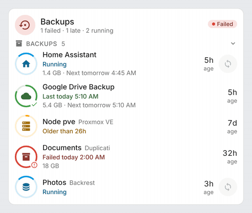 | 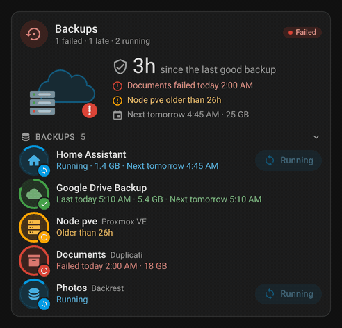 |

### Full card

Five sources: three up to date, a Proxmox node backed up a week ago (late), a Duplicati job that failed this night:

| Light | Dark |
|---|---|
|  | 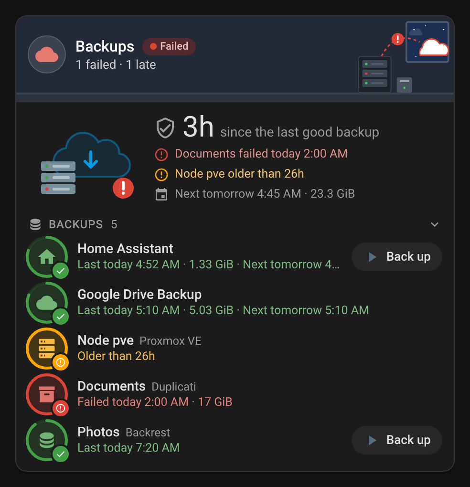 |

Everything up to date, without the summary:

| Light | Dark |
|---|---|
| 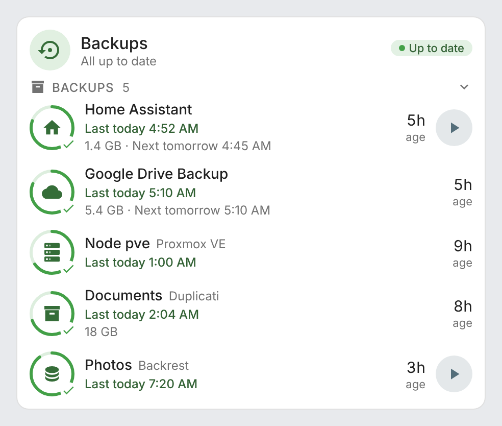 | 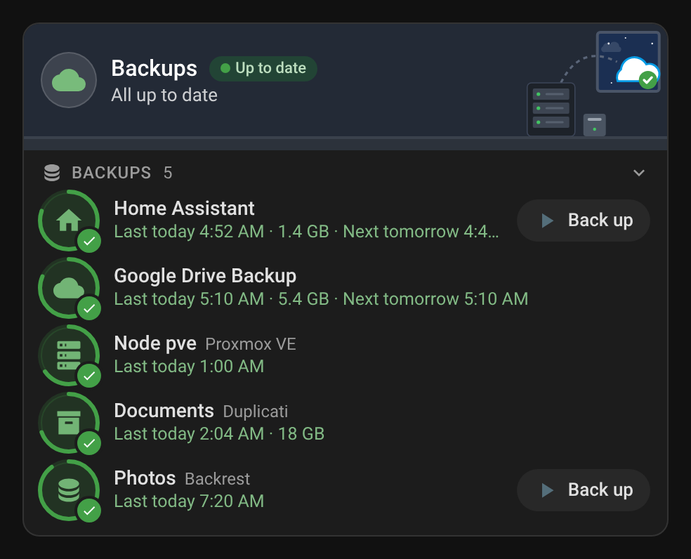 |

### Mini card

| Light | Dark |
|---|---|
|  | 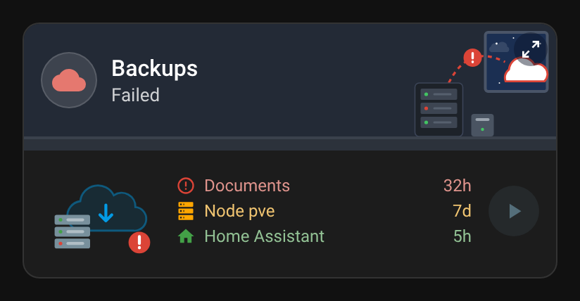 |
|  | 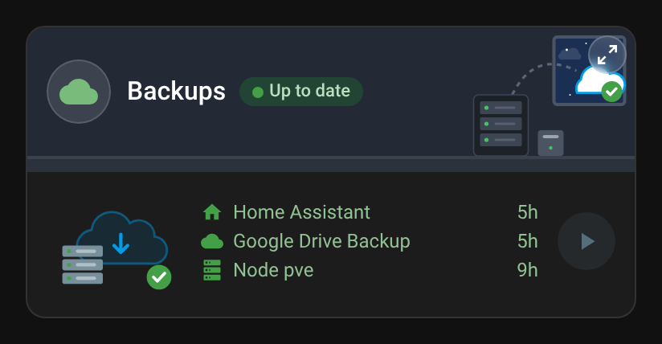 |

The detail button (top right) shows the full card's content:

| Light | Dark |
|---|---|
| 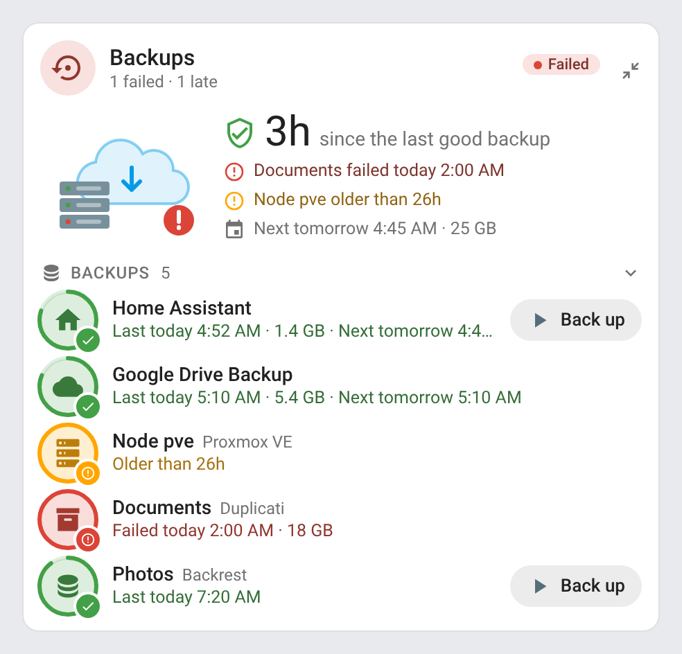 | 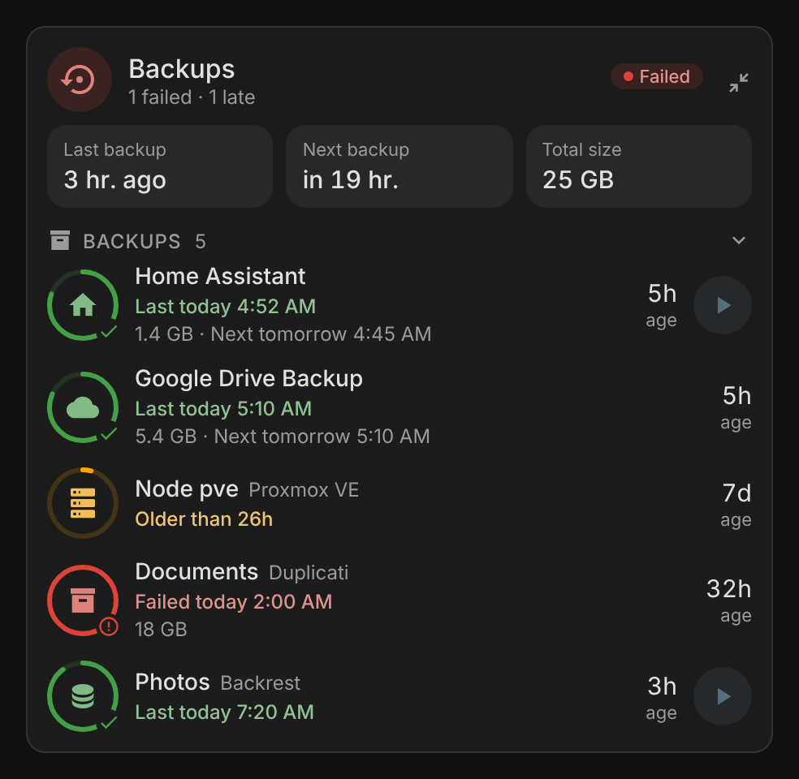 |

### Narrow cards

The full card at 6 columns of a phone's Sections view (the summary with a smaller illustration) and the mini card at its minimum width:

| Light | Dark |
|---|---|
| 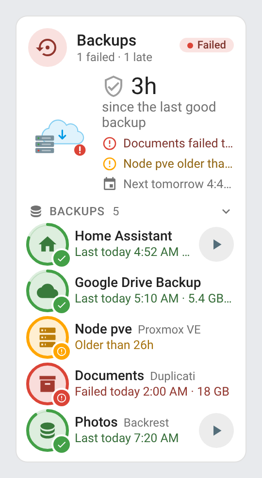 | 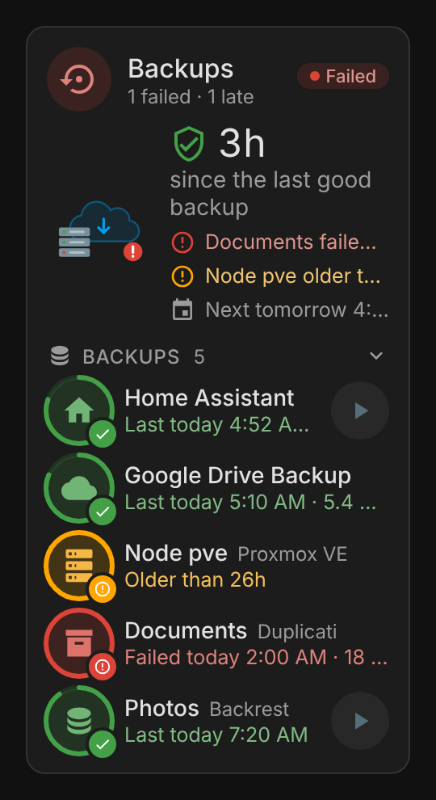 |
| 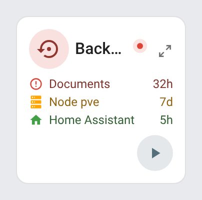 | 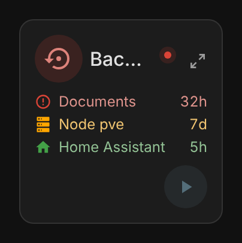 |

## How it works

The cards read the Home Assistant entity and device registries instead of relying on entity ids: the parts of a source are the entities of its device, recognised by their translation key or name (*last successful* / *last backup*, *last attempt*, *last failure*, *status* / *state* / *result*, *next*, *size* — not the total nor the free space —, a *running* and a *failed* binary sensor, a *backup* / *run* / *trigger* button). Entity ids can therefore be in any language or renamed. For Proxmox VE, only the entities about backups are read, so that a node's status, health and power buttons never pass for its backups.

- **Age**: from the last good backup to now, against `max_age` (the card's, or the source's own).
- **Failed**: an attempt or a failure later than the last good backup, a status with *error* or *fail*, or a failed binary sensor that is on.
- **Running**: a running binary sensor that is on, a status that says so (Home Assistant's *create_backup*), or a backup started from the card that has not reported yet.
- **Sizes**: converted from the sensor's unit (B to TB, KiB to TiB) and shown in the largest unit that fits.

## Development

```bash
npm install
npm run build        # bundles src/backup-card.js into dist/backup-card.js (and its translation files)
npm run check        # builds and checks the card (run in CI)
npm test             # unit tests
npm run screenshots  # renders the cards (and one GIF per animated state, needs ffmpeg) with mock data into screenshots/
```

The source is split into ES modules under `src/` (entry `src/index.js`); `npm run build` assembles them (`scripts/bundle.mjs`) into the single file the Marketplace serves.

`dist/` is not committed: `npm run build` creates it locally, CI builds it on every push, and the release workflow attaches the built files to the release, which is where the Marketplace installs it from. The captures are rendered on a fixed clock with mock data (scripts/mock-states.mjs) and rewritten only when their pixels change, exactly; on a pull request, the **Screenshots** workflow commits them to the pull request's branch.

### Releasing

1. Bump `version` in `package.json` (and `package-lock.json`, with `npm install`)
2. Add a `## <version>` section at the top of [CHANGELOG.md](https://github.com/juju35/ha-backup-card/blob/main/CHANGELOG.md)
3. Push to `main`: the **Release** workflow builds the card, creates the tag and the GitHub release with the changelog section as notes, and attaches `backup-card.js` and its translation files

## Translations

The cards auto-detect the language from your Home Assistant settings. Currently supported:

| Language | Code |
|---|---|
| English | `en` |
| Français | `fr` |
| Deutsch | `de` |
| Español | `es` |
| Српски | `sr` |
| Srpski (latinica) | `sr-Latn` |
| Italiano | `it` |
| Nederlands | `nl` |
| Português (European; also used for `pt-BR`) | `pt` |
| Polski | `pl` |
| Română | `ro` |
| Dansk | `da` |
| Svenska | `sv` |
| Български | `bg` |
| Русский | `ru` |
| Українська | `uk` |
| Magyar | `hu` |
| Slovenčina | `sk` |
| Čeština | `cs` |
| Slovenščina | `sl` |
| Latviešu | `lv` |
| Ελληνικά | `el` |

English is in the card's file; every other language is in its own small file (`backup-card.i18n.<lang>.js`), loaded only when needed. Contributions for additional languages are welcome!

## Credits

Proxmox is a trademark of Proxmox Server Solutions GmbH; Duplicati, Backrest and Veeam are trademarks of their owners; Google Drive is a trademark of Google LLC; OneDrive is a trademark of Microsoft Corporation. This project is not affiliated with any of them. Icons from [Material Design Icons](https://pictogrammers.com/library/mdi/).

## License

[MIT](https://github.com/juju35/ha-backup-card/blob/main/LICENSE)

## Support

If you find this project useful, you can support its development:

<a href="https://buymeacoffee.com/julienstep9"></a>
